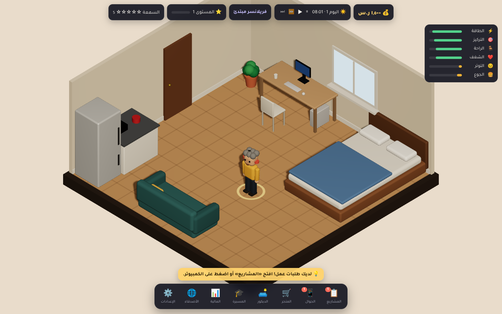

# Freelancer Life Simulator — حياة فريلانسر

لعبة محاكاة ثلاثية الأبعاد للمتصفح بمنظور **إيزومتري (Diorama / Cutaway)**: تبدأ فريلانسر في غرفتك، تستقبل طلبات العملاء،
تنفّذ العمل **بيدك** داخل أدوات مصغّرة تحاكي برامج المونتاج والموشن والجرافيك والثري دي، تكسب المال والسمعة، تطوّر أجهزتك وغرفتك،
توازن بين العمل والراحة، تتعاون **أونلاين** مع أصدقائك، ثم تفتح استوديو وتوظّف فريقًا وصولًا إلى شركة إنتاج إبداعي.

> A browser 3D life/career sim: from a junior freelancer in a small room to the founder of a creative production company — with real hands-on mini work tools, an economy, needs/burnout, room customization, staff management and real online co-op.



---

## ما الذي تم بناؤه (وتم اختباره فعليًا)

| النظام | الحالة |
|---|---|
| غرفة ثلاثية الأبعاد إيزومترية بجدران مقطوعة، إضاءة دافئة ودورة ليل/نهار مرتبطة بساعة اللعبة | ✅ |
| شخصية متحركة (مشي، جلوس وكتابة، نوم، أكل، جوال) + تحريك بالنقر مع Pathfinding (A*) | ✅ |
| إنشاء شخصية (الاسم، البشرة، الشعر، الملابس، الإكسسوار، اسم الحفظ) + 4 تخصصات | ✅ |
| مولّد مشاريع متدرّج (عملاء خياليون، ميزانية، مدة، صعوبة 1–5، تعديلات، RAM مطلوبة) + تفاوض + انتهاء العروض | ✅ |
| **أدوات عمل تفاعلية حقيقية** لكل تخصص مع تحقق آلي من المتطلبات (انظر أدناه) | ✅ |
| التسليم، التصدير (مدته تعتمد على المعالج/كرت الشاشة/التخزين)، تقييم العميل، تعديلات منطقية، الدفع، التأخير والإلغاء | ✅ |
| اقتصاد بالريال السعودي: دخل، مشتريات، رواتب، إيجار، تشغيل، دورات، سجل مالي | ✅ |
| متجر أجهزة وأثاث (CPU, GPU, RAM, SSD, شاشات, لوحة مفاتيح, فأرة, سماعات, مكتب, كرسي, إضاءة) بتأثير وظيفي **وبصري** | ✅ |
| تخصيص الغرفة: دهانات وورق جدران وأرضيات، ديكور يوضع على شبكة بمنع التداخل، تدوير/نقل/تخزين، توسعة الغرفة | ✅ |
| احتياجات الشخصية (الطاقة، التركيز، الراحة، الشغف، التوتر، الجوع) + احتراق وظيفي + نوم/أكل/طلب أكل/قهوة/استراحة/إجازة + لعبة مصغّرة «صائد الأفكار» | ✅ |
| التسلسل المهني بخمس مراحل مع شروط (المستوى، السمعة، المشاريع، الموظفون، المال) | ✅ |
| مستقلون للتعاقد، موظفون بخصائص (جودة، سرعة، تحمّل ضغط، راتب، طاقة، رضا)، تدريب، طلب زيادة، استقالة | ✅ |
| الأقسام، المنسّق، مدير المشاريع، خط سير العمل: العميل ← المنسّق ← المدير ← الأقسام ← المراجعة ← العميل | ✅ |
| أونلاين حقيقي: حسابات، حفظ على الخادم، رموز دعوة، صلاحيات (مالك/شريك/مساعد)، مزامنة الحركة والمهام، توزيع الأرباح، منع التكرار، إعادة الاتصال | ✅ |
| واجهة عربية RTL كاملة + إنجليزية، مؤثرات صوتية مولّدة (بدون موسيقى افتراضيًا) مع كتم | ✅ |
| حفظ واستعادة: PostgreSQL (أونلاين) أو localStorage (محلي بدون إنترنت) | ✅ |

### أدوات العمل (قلب اللعبة)
- **محرّر «لقطة» للمونتاج:** معاينة، تايملاين بمسارات V1/V2/T/A1، قص عند المؤشر (S)، حذف (Del)، سحب وإفلات لإعادة الترتيب، نصوص بتوقيت ولون وموضع، انتقالات، مكتبة موسيقى ومستوى صوت، تصحيح ألوان، طبقة علوية B-roll. المتطلبات مثل «احذف من الثانية 5 إلى 8» تُتحقق رياضيًا على مستوى مصدر اللقطة.
- **«حركة ستوديو» للموشن جرافيك:** مسرح بطبقات، Keyframes لـ X/Y/الشفافية/الحجم/الدوران، منحنيات Ease (مع رسم المنحنى)، سحب العناصر مع مفتاح تلقائي، تايملاين مفاتيح. التحقق بتقييم الحركة عند أزمنة محددة.
- **«لوحة ديزاين» للجرافيك:** لوح تصميم، سحب وتغيير حجم، محاذاة، ألوان، خطوط عربية، طبقات، إضافة عناصر، خطوط محاذاة ذكية.
- **«مجسّم» للثري دي:** مشهد WebGL حقيقي، إضافة مجسمات، الموقع/الحجم/الدوران، خامات (معدن، زجاج، خشب، رخام، مضيء)، إضاءة دافئة/باردة، Rim light.

الصعوبة تتدرّج (5 مستويات) حسب مهارتك في التخصص ومرحلتك المهنية. المساعدة داخل اللعبة (إبراز الأداة، تحديد مكان القص، تلميحات، تحقق مباشر) قابلة للإيقاف من الإعدادات.
الترقيات تؤثر على اللعب: الشاشة الأفضل تكبّر التايملاين وتضيف محاذاة ذكية، المعالج/الكرت يسرّع التصدير، الذاكرة تفتح مشاريع أكبر، الكرسي يقلل التعب، والتركيز المنخفض يسبب أخطاء فعلية في القص والسحب.

---

## البنية التقنية

```
shared/   منطق المحاكاة الخالص (TypeScript) — يعمل في المتصفح وعلى الخادم بنفس الكود
  src/engine.ts      المخفّض الرئيسي applyAction(state, action, ctx) + محاكاة الوقت والاحتياجات والموظفين والإدارة
  src/work/*.ts      أدوات العمل الأربع: توليد المهام، العمليات، التحقق، طلبات التعديل، تعقيم المدخلات
  src/generate.ts    توليد العروض والعملاء والمرشحين والمستقلين
  src/data/*.ts      الكتالوج، المراحل، التخصصات، الأسماء (قابلة للتوسعة بإضافة بيانات فقط)
server/   خادم Node: REST + WebSocket، غرف لعب موثوقة (Authoritative)، PostgreSQL أو ملف JSON
  db/schema.sql      مخطط قاعدة البيانات (يُطبّق تلقائيًا عند التشغيل)
client/   React + Vite + Three.js / React Three Fiber + Zustand
  src/scene/         العالم ثلاثي الأبعاد: الغرفة، الأثاث، الشخصيات (نماذج أصلية مبنية من مجسمات بسيطة)، الكاميرا
  src/editors/       واجهات أدوات العمل
  src/ui/            القوائم، HUD، اللوحات، شاشة الكمبيوتر
e2e/      سيناريو اختبار كامل في متصفحين حقيقيين
```

- **فصل المنطق عن الواجهة والرسومات:** كل تغيير في اللعبة هو `Action` يمرّ عبر `applyAction` في `shared`. الواجهة لا تعدّل الحالة مباشرة.
- **الأمان الاقتصادي:** في الحفظ الأونلاين يطبّق الخادم وحده الإجراءات (العميل لا يرسل أرقام مال). كل إجراء له معرّف فريد؛ إعادة الإرسال بعد انقطاع لا تُطبّق مرتين. المهمة المنجزة لا تُسلّم مرتين. حصة الصديق تُودع في حسابه عبر `bank_ledger` بمفتاح فريد لكل (عالم، مشروع، لاعب) فلا تتكرر.
- **لا مفاتيح سرية في المتصفح:** الخادم يحمل اتصال قاعدة البيانات فقط؛ كلمات المرور مُجزّأة (scrypt) والجلسات مُخزّنة كـ SHA-256.
- **القابلية للتوسع:** إضافة تخصص = وحدة `WorkModule` جديدة + محرر. إضافة أثاث/أجهزة = سطر في `catalog.ts`. إضافة مرحلة/وظيفة = بيانات في `stages.ts`.
- **اختيار تقني:** بدل Supabase استخدمتُ خادم Node خاصًا مع PostgreSQL و WebSockets، لأن اللعب الجماعي يحتاج خادمًا موثوقًا يشغّل المحاكاة ويتحقق من كل عملية؛ أي PostgreSQL مُدار (بما فيها Supabase Postgres) يعمل عبر `DATABASE_URL`.

---

## التشغيل المحلي

المتطلبات: Node.js 20+ (ويفضّل PostgreSQL 14+).

```bash
npm install
cp .env.example .env        # اختياري
# قاعدة بيانات (اختياري — بدونها يستخدم الخادم ملف JSON محلي للتطوير)
createdb fls && export DATABASE_URL=postgres://localhost:5432/fls

npm run dev                 # الخادم على 8787 والواجهة على http://localhost:5173 (مع proxy)
```

أو نسخة إنتاج على منفذ واحد:
```bash
npm run build && DATABASE_URL=... npm start   # http://localhost:8787
```

**تجربة اللعب الجماعي:** افتح اللعبة في متصفحين (أو جهازين على نفس الشبكة عبر `http://IP:5173`)، أنشئ حسابين، أنشئ «حفظ أونلاين» في الأول،
من «الأصدقاء» أنشئ رمز دعوة، وأدخله في القائمة الرئيسية للثاني.

---

## الاختبارات

```bash
npm test                                   # 149 اختبار: أدوات العمل، الاقتصاد، المراحل، الأونلاين عبر WebSocket حقيقي
TEST_DATABASE_URL=postgres://.../fls_test npm test   # نفس اختبارات الخادم على PostgreSQL حقيقي
npm run build && npm run e2e               # سيناريو كامل في متصفحين (Playwright + Chromium)
npm run typecheck
```

- `shared/test/work.test.ts` — كل مهمة مولّدة (125 مهمة مونتاج بخمس صعوبات + موشن + جرافيك + ثري دي) قابلة للحل بعمليات المحرر فقط، والعمل الناقص يفشل.
- `shared/test/engine.test.ts` — دورة القبول→العمل→التسليم→الدفع مرة واحدة، رفض التسليم المكرر، التعديلات، شراء الترقيات وأثرها، الاحتياجات والنوم، منع تداخل الأثاث، فشل المواعيد، المصاريف الأسبوعية، تقسيم الأرباح، التدرّج حتى المرحلة الخامسة مع المنسّق ومدير المشاريع.
- `server/test/multiplayer.test.ts` — حسابات، دعوات، عضوية، مزامنة الحركة والتقدم، قبول متزامن لنفس العرض (ينجح واحد فقط)، تسليم مكرر بنفس المعرّف، انقطاع وإعادة اتصال دون تكرار الشراء، إعادة تشغيل الخادم واستمرار البيانات، تحويل أرباح التعاون مرة واحدة.
- `e2e/full-scenario.mjs` — سيناريو البند 20 من المتطلبات في متصفحين منفصلين (انظر `docs/TESTING.md` للنتائج).

---

## النشر

- **خدمة واحدة (موصى بها):** `Dockerfile` + `render.yaml` (Render.com: خدمة ويب + PostgreSQL مُدار). أي منصة تدعم Docker و WebSockets تعمل (Fly.io, Railway).
- **واجهة منفصلة على Vercel/Netlify:** `vercel.json` / `netlify.toml` جاهزان. اضبط `VITE_SERVER_URL` على رابط الخادم، و`CORS_ORIGIN` على رابط الواجهة في الخادم.
  ملاحظة: Vercel/Netlify لا يستضيفان خادم WebSocket دائمًا، لذلك يجب تشغيل الخادم على منصة أخرى.

لم يتم النشر من بيئة التطوير هذه لعدم توفر صلاحيات/حسابات استضافة. الخطوات الدقيقة في `docs/DEPLOY.md`.

---

## ما ينقص / حدود معروفة
راجع `docs/PROGRESS.md` (تُحدَّث مع كل مرحلة) لقائمة ما اكتمل وما بقي، ومنها: الحفظ المحلي يعمل في المتصفح ويمكن التلاعب به (اللعب الجماعي محمي لأنه على الخادم)،
النماذج ثلاثية الأبعاد مبنية برمجيًا من مجسمات أصلية (لا ملفات glTF)، ولا يوجد نشر فعلي بعد.
