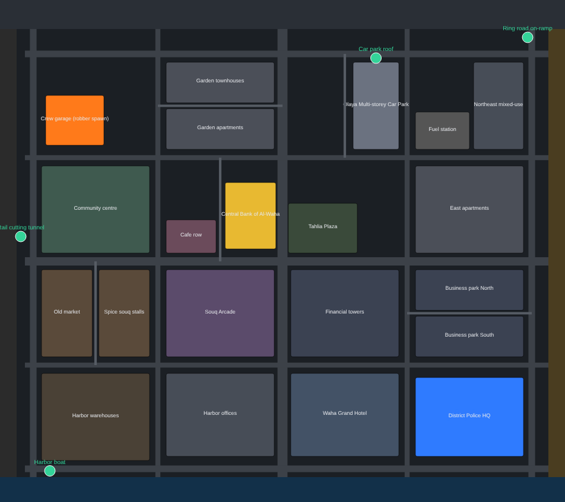

# HEIST RESPONSE — Police vs. Robbers

Online multiplayer heist game for Windows, built with Unreal Engine 5 (C++).
4 police vs 4 robbers in a semi-open city district: stealth or loud bank robberies, lockpicking, vault drilling,
hostages and negotiation, arrests, and vehicle pursuits. Arabic-first UI with English.

- Unreal project: [`HeistResponse/`](HeistResponse/)
- Start here: [`CLAUDE.md`](CLAUDE.md) · [`Docs/PROJECT_STATUS.md`](Docs/PROJECT_STATUS.md) · [`Docs/GAME_DESIGN_DOCUMENT.md`](Docs/GAME_DESIGN_DOCUMENT.md)
- City plan: 

## Quick start (Windows)
1. Install Unreal Engine 5.6+ (Epic Games Launcher) and Visual Studio 2022 with "Game development with C++".
2. `git lfs install` then clone.
3. Right-click `HeistResponse/HeistResponse.uproject` → *Generate Visual Studio project files* → open and build `HeistResponseEditor`.
4. In the editor: *Tools → Execute Python Script* → `HeistResponse/Tools/Editor/build_district.py`.
5. Play with Net Mode "Listen Server", 2+ players.

## Checks that run anywhere
```bash
cmake -S HeistResponse/Tests/CoreRules -B build/core && cmake --build build/core && ctest --test-dir build/core
python3 HeistResponse/Tools/validate_strings.py
python3 HeistResponse/Tools/CityLayout/validate_layout.py
```
